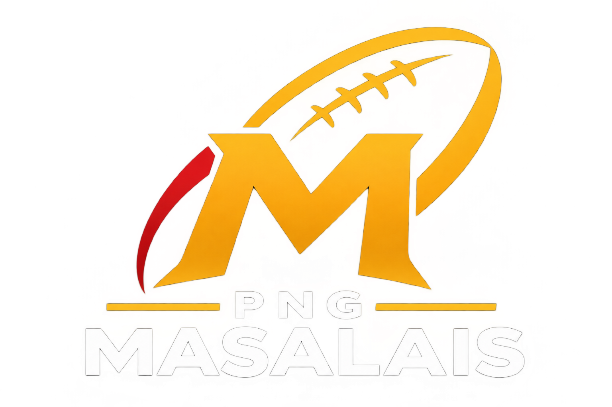
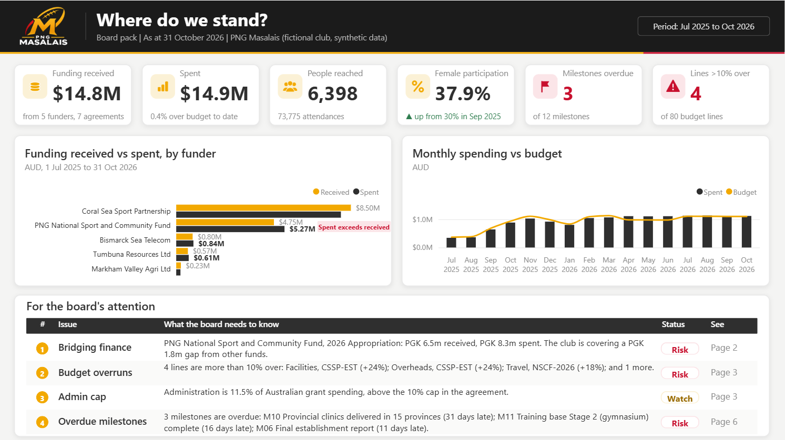
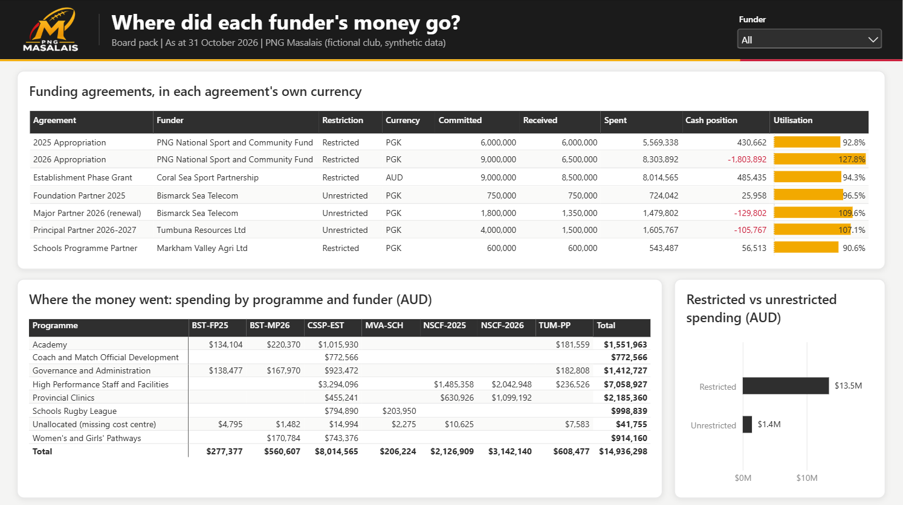
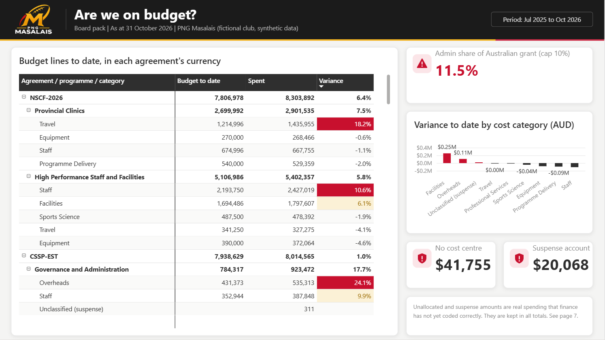
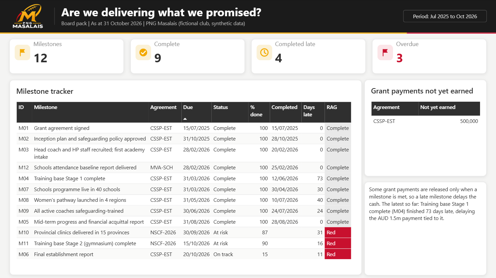
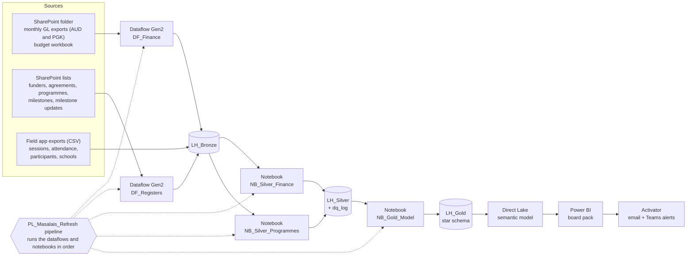

<p align="center">
  
</p>

<h1 align="center">PNG Masalais: Funding and Impact Platform</h1>

<p align="center">
  <b>Microsoft Fabric</b> · Dataflow Gen2 · PySpark · Lakehouse medallion · Direct Lake · Power BI · Data pipeline · Activator
</p>

<p align="center"><i>Fictional club. All data is synthetic and was generated for this project.</i></p>

---

## The problem

The PNG Masalais are a fictional national rugby league club in their establishment phase (July 2025 to October 2026), getting ready to join a professional competition. The club is funded by:

- an **Australian donor grant** paid in **AUD**, released in tranches when milestones are met
- a **PNG Government contribution** paid in **PGK**, released through each year's national budget
- three **corporate sponsors**, some restricted to specific programmes

The money pays for high performance staff and facilities, an academy, schools rugby league, women's and girls' pathways, provincial clinics and coach development.

The board has to answer to every funder: **where did your money go, and what did it achieve?** That is harder than it sounds:

- two legal entities with **two accounting systems** that export differently
- **two currencies** and **two financial years** (Australia runs July to June, PNG runs on the calendar year)
- funders with **different rules** (restricted vs unrestricted money, an admin cap, milestone-linked payments)
- delivery data from a **field app** typed in by programme officers, with the errors that come with that

This project builds the club's reporting platform end to end, from raw files to a board pack that writes its own commentary and alerts the board when something goes wrong.

## Demo


https://github.com/user-attachments/assets/cde6e8fb-cb68-4474-8445-3147f52e7bd8


*A funder brings a deadline forward and finance posts a late payroll journal. One pipeline run later, the board pack has updated itself (including its written commentary) and Activator has alerted the board by email and Teams.*

## What the board sees

| | |
|---|---|
|  |  |
| **Where do we stand?** KPIs, funding vs spend by funder, and a "for the board's attention" panel that is calculated, not typed. | **Where did each funder's money go?** Every agreement judged in its own currency, including a restricted grant that is PGK 1.8m overspent against receipts. |
|  |  |
| **Are we on budget?** Budget lines by agreement, programme and cost category, with lines over 10% in red and the 10% admin cap checked. | **Are we delivering what we promised?** Milestone tracker with a calculated RAG status alongside the status staff reported. |

*Screenshots show the board pack after the demo run: milestone M06 brought forward and a late PGK 60,000 payroll journal posted, so three milestones are overdue and four budget lines are more than 10% over.*

Other pages cover programme reach (people, not attendances), school attendance in programme schools vs comparison schools, and a data quality page showing everything the pipeline fixed or flagged.

## Architecture



**One rule decides what goes where:**

| Layer | Tool | Job |
|---|---|---|
| Ingest | Dataflow Gen2 | Connect and shape: combine monthly files, pick the right Excel table, unpivot the budget. No business rules. |
| Bronze | Lakehouse | Data exactly as it arrived. |
| Silver | PySpark notebooks | Business rules and data quality: dedupe, standardise, correct, flag, and log every decision. |
| Gold | PySpark notebook | Star schema. Business logic is decided **once** here (agreement currency amounts, overdue flags, before/after flags), so every report page gives the same answer and the DAX stays simple. |
| Serve | Direct Lake model and Power BI | Reads Gold directly. No import refresh. |
| Act | Activator | Watches the published report and alerts the board. |

## How it was built

### 1. Synthetic data with real problems in it
Python generators (`generator/`) create two years of finance and delivery data with **storylines and data quality issues planted on purpose**, plus an answer key (`data/_answer_key/`) so every layer could be reconciled:

- AU ledger exported Xero-style (dd/mm/yyyy text dates, separate debit and credit columns); PNG ledger in a different system (real dates, signed amounts, different column names)
- a March export that repeats all of February (14 duplicate journals)
- 71 fund codes typed inconsistently, 28 expense lines with no cost centre, 6 lines in a suspense account
- 384 gender values typed differently, 30 resubmitted sessions, 22 attendance rows for people missing from the register
- a milestone that finishes late and delays a grant payment, a government release that arrives short, an admin overspend

### 2. Ingestion
- **DF_Finance** combines a SharePoint folder of 32 monthly GL files from two systems, picking the Excel *table* rather than the sheet so title rows are skipped, and unpivots the wide budget.
- **DF_Registers** reads the five SharePoint lists.
- AU dates are kept as **text in Bronze** and parsed explicitly in Silver. Letting Power Query guess turned 01/09/2025 into 9 January and failed every date after the 12th.

### 3. Silver: rules and a data quality log
Three principles, applied to 595 issues:
1. **Never drop real money.** A line with no cost centre is real spending, so it stays in every total as `UNALLOCATED` and is flagged.
2. **Only remove what isn't real.** The 14 duplicate journals are removed; nothing else is.
3. **Log every decision** with the original value, in `dq_log`, which feeds a page in the report.

### 4. Gold and the semantic model
Star schema with 16 tables in a lakehouse, read by a **Direct Lake** model with 23 one-directional relationships and more than 50 measures. The date table carries both financial years and school terms.

### 5. A board pack that writes its own commentary
The "for the board's attention" panel is **measure-driven**. Each row has a text measure and a status measure with a written rule, for example:

- **Bridging finance:** Risk when any *restricted* agreement has spent more than it has received
- **Budget overruns:** Risk when any budget line is more than 10% over budget to date
- **Admin cap:** Watch above 10%, Risk above 12%
- **Overdue milestones:** Risk when an overdue milestone has grant money tied to it, Watch otherwise

When an issue clears, the row says so and turns green.

### 6. Orchestration and alerts
- **PL_Masalais_Refresh** runs both dataflows in parallel, then the three notebooks in order, each on "on success", so a failure never leaves half-updated numbers in Gold.
- **Activator** watches a hidden "Alert feeds" page: a new overdue milestone triggers an email, and a new budget line over 10% triggers a Teams message.

## Data quality in numbers

| Check | Bronze | Silver | What happened |
|---|---:|---:|---|
| AU GL lines | 200 | 186 | 14 duplicate journals removed |
| PNG GL lines | 3,624 | 3,624 | 71 fund codes corrected, 28 flagged UNALLOCATED, 6 flagged unknown account |
| Sessions | 2,033 | 2,003 | 30 resubmissions removed (latest kept), 40 provinces filled from the school |
| Attendance | 73,797 | 73,775 | 22 rows for unregistered people set aside |
| Participants | 6,400 | 6,400 | 384 gender values standardised; 6,398 actually attended |

The PNG ledger's net total is identical in Bronze and Silver: nothing real was lost.

## Design decisions (interview talking points)

1. **Each agreement is judged in its own currency.** Converting the PNG grant to AUD would make exchange rate movements look like over or under spending. Agreement-currency measures return blank when currencies are mixed (`HASONEVALUE`), so the report can never add AUD to PGK; board totals use a separate AUD measure.
2. **A data quality issue can hide a budget overrun.** The Australian grant's admin staff line was 10.2% over until 28 lines with no cost centre were set aside as UNALLOCATED, which took it just under the 10% threshold. Keeping UNALLOCATED visible, instead of guessing where it belongs, is what lets finance find it.
3. **Status is what people say; RAG is what the data says.** In the demo, milestone M06 still reports "On track" from its last update, but the calculated RAG flags it Red the moment its due date passes. The board sees both.
4. **Fix problems at the source.** SharePoint list dates arrived 17 hours early in July and 18 in December. The one-hour difference pointed to daylight saving, which Brisbane doesn't have: the new site had defaulted to US Pacific time. Fixing the site's regional settings corrected every list at once, instead of patching each query.
5. **Alerts need data shaped for them.** Activator treats a date column in a table as a time axis and only reacts to new changes. A hidden page with one table per alert (an ID and the value being watched, no dates) gives clean per-item alerts.
6. **Build with AI, but give it a way to check its own work.** The model and report were built with Claude Code using Microsoft's Power BI modeling MCP server and report authoring CLI, working from written specs. Early rounds passed file validation but looked wrong on screen. Adding a mockup image and letting the agent screenshot the report and compare it against the mockup is what got the design right.

## What I'd do differently in production

- Run pipeline activities under a **workspace identity or service principal** (this build uses a workspace identity with Contributor access) and keep connections out of personal accounts.
- **Schedule** the pipeline and switch the GL load to **incremental**, rather than reloading every file.
- Add **row-level security by funder**, so each funder sees only their own agreements.
- Use **deployment pipelines** (dev, test, prod) rather than editing one workspace.
- Replace the field app CSV drops with a direct feed into OneLake.

## Cost

**$0.** Built on a Microsoft Fabric trial capacity (F64 equivalent) and an existing Microsoft 365 tenant. The Power BI modeling MCP server, report authoring CLI and Azure CLI are free.

## Repository layout

```
png-masalais-fabric/
├── README.md
├── generator/          Python scripts that create the synthetic data and icons
├── data/               Generated source files (finance, field app, FX, reference) and the answer key
├── notebooks/          Silver and Gold PySpark notebooks (.ipynb)
├── report/             Power BI board pack as a PBIP project (PBIR format, live connection)
├── docs/               Model spec, report spec, design spec, review rounds and the page mockup
├── assets/             Logo, KPI icons, screenshots and the demo video
└── fabric/             Fabric workspace items synced through Git integration
```

## Reproduce it

1. Run `generator/01_reference.py`, `02_finance.py` and `03_programmes.py` (Python 3, pandas, openpyxl) to regenerate `data/`.
2. Upload `data/finance/` and the reference lists to a SharePoint site, and `data/field/`, `data/fx/` and two reference CSVs to a lakehouse called `LH_Bronze`.
3. Build the two dataflows as described above, import the three notebooks, and run them in order (Bronze as default lakehouse for Silver, Silver as default for Gold).
4. Create a Direct Lake semantic model on `LH_Gold` and apply `docs/model_spec.md`.
5. Open `report/Masalais_Board_Pack.pbip` in Power BI Desktop and point it at your model.

---

<p align="center"><i>PNG Masalais is a fictional club. Names of funders and sponsors are invented. Any resemblance to real organisations is unintended.</i></p>
